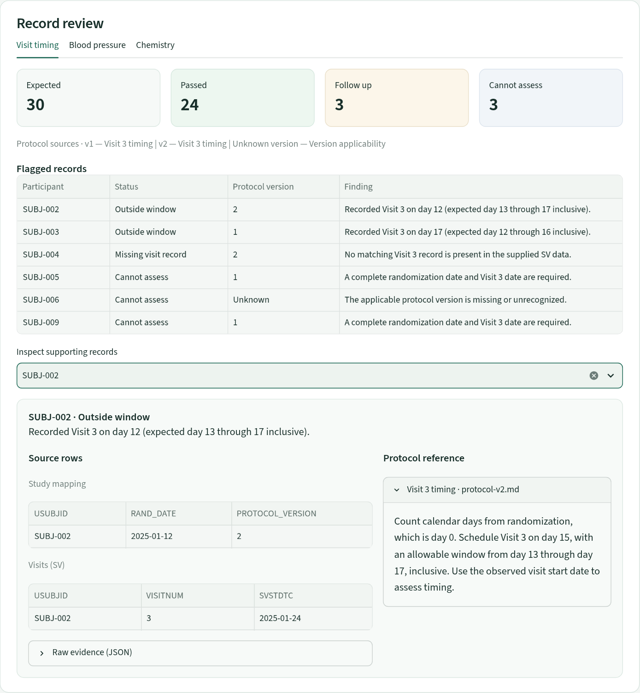
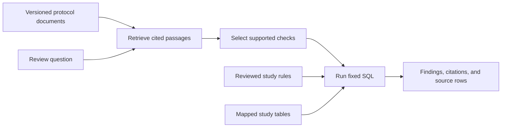

# Protocol to SDTM Review

**Review clinical study records against their protocol and trace each finding to its evidence.**

The goal is to reuse this workflow across studies with versioned protocol
documents, mapped datasets, and reviewed rules. The current app runs on
one bundled synthetic study. New document layouts, table mappings, or
requirements can require code changes.

[Run locally](#run-locally) · [Architecture](#architecture) · [Verify the findings](#verify-the-findings)

## Explore the demo

The demo uses **30 synthetic participants**, **two protocol versions**, and
**three Visit 3 checks** covering timing, blood pressure, and chemistry.
[Study packet](demo/study/README.md)

> **Try the default question**
>
> Summarize discrepancies between the data and the protocol.

Open the **Visit timing** results and inspect **SUBJ-002**. Its visit was
recorded on day 12. The applicable version 2 protocol allows days 13–17.
The app shows the protocol excerpt alongside the source records.



## Run locally

Use Python 3.12 from the repository root.

```bash
python -m venv .venv
source .venv/bin/activate
python -m pip install -r requirements.txt
python -m streamlit run app.py
```

Open the local URL printed by Streamlit and click **Review study**. The
default review runs offline. To enable OpenAI routing for other questions,
set `OPENAI_API_KEY` on the server before starting the app. `OPENAI_MODEL`
overrides `gpt-4o-mini`. Hosted routing receives the question and retrieved
protocol excerpts. Dataset rows stay local.

## Architecture



| Component | Why it fits the review workflow |
| --- | --- |
| **LangChain** | Connects question routing to retrieved protocol sections with source metadata. Version and section citations let reviewers verify which requirement applies as protocols change. |
| **Pydantic** | Validates the optional model's choice against a defined set of checks. Each study's reviewed rules supply the parameters used in those checks. |
| **DuckDB** | Embedded SQL joins mapped tables, evaluates rules, and returns the rows behind each finding. Reviewers can inspect and reproduce the logic locally without running a database server. |
| **Streamlit** | Gives reviewers a browser interface for inspecting findings alongside protocol excerpts and source rows. The checks can also run directly from Python for testing. |

The review flags absences in the supplied data and records it cannot assess.
Whether a flagged record represents a protocol deviation requires follow-up.
[Design and scope](docs/design.md)

## Verify the findings

```bash
python -m unittest discover -s tests -v
```

The tests compare the app's results with the expected participant-level
findings for all three checks. [Expected findings](demo/study/expected_findings.json)
