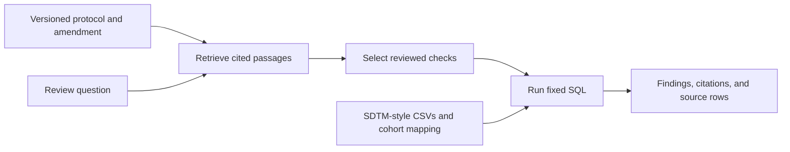

# Protocol to SDTM Review

**Trace a flagged study record back to the protocol requirement and the data behind it.**

[Run locally](#run-locally) · [Architecture](#architecture) · [Verify the findings](#verify-the-findings)

## Explore the demo

Aster Brook is a fictional study with **30 synthetic participants**, **two
protocol versions**, and **three Visit 3 checks** covering timing, blood
pressure, and chemistry. [Study packet](demo/study/README.md)

> **Try the default question**
>
> Summarize discrepancies between the data and the protocol.

Open the **Visit timing** results and inspect **AB-002**. Its visit was
recorded on day 12. The applicable version 2 protocol allows days 13–17.
The app shows the protocol excerpt alongside the source records.

## Run locally

Use Python 3.12 from the repository root.

```bash
python -m venv .venv
source .venv/bin/activate
python -m pip install -r requirements.txt
python -m streamlit run app.py
```

Open the local URL printed by Streamlit and click **Review study**. The
default review runs offline. To enable OpenAI routing for other questions,
set `OPENAI_API_KEY` on the server before starting the app. `OPENAI_MODEL`
overrides `gpt-4o-mini`. Hosted routing receives the question and retrieved
protocol excerpts. Dataset rows stay local.

## Architecture



| Decision | Why it fits |
| --- | --- |
| **LangChain retrieves complete Markdown sections** | Local lexical search fits a small corpus and keeps each schedule table with its version and citation. |
| **Pydantic validates optional model routing** | A structured model response can select only supported checks. Reviewed rules supply the visit windows and test codes. |
| **DuckDB runs fixed SQL** | The joins start from the expected cohort, so missing visits stay in the denominator. The same files and rules reproduce the same findings. |
| **Streamlit shows the evidence** | A reviewer can inspect the flagged records and the applicable protocol passage in the same session. |

The review flags absences in the supplied data and records it cannot assess.
Whether a flagged record represents a protocol deviation requires follow-up.
[Design and scope](docs/design.md)

## Verify the findings

```bash
python -m unittest discover -s tests -v
```

The tests compare the app's results with the expected participant-level
findings for all three checks. [Expected findings](demo/study/expected_findings.json)
